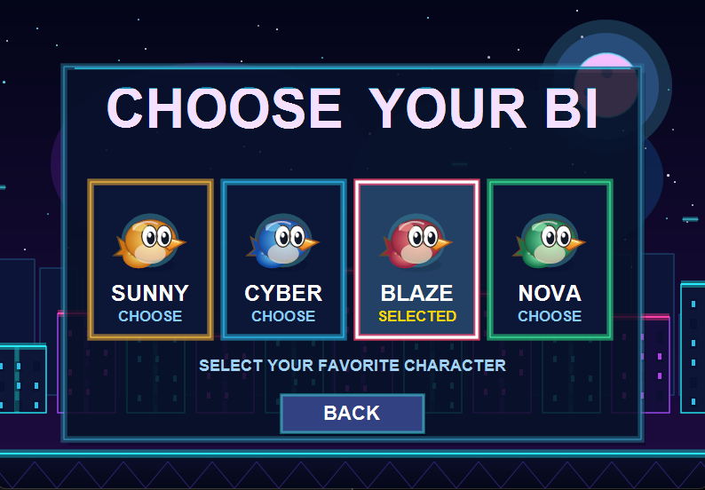

# 🐦 Neon Flappy Bird

<p align="center">
  <strong>YMH219 – Nesne Tabanlı Programlama</strong><br>
  C# ve Windows Forms ile geliştirilen, neon gece temalı 2D arcade oyunu.
</p>

<p align="center">
  
  
  
  
</p>

---

## 🎮 Proje Hakkında

**Neon Flappy Bird**, klasik Flappy Bird oyunundan esinlenerek C# ve Windows Forms kullanılarak geliştirilmiş bir masaüstü arcade oyunudur. Oyuncu, seçtiği kuşla neon ışıklı gece atmosferinde engellerin arasından geçmeye, puan kazanmaya ve altın coin toplamaya çalışır.

Oyun; animasyon, çarpışma kontrolü, puan ve coin sistemi, zorluk seviyeleri ve oyuncu verilerinin yerel olarak saklanması gibi özellikler içerir.

## ✨ Özellikler

- 🌃 **Neon Night teması:** Yıldızlar, ay ve neon ışıklı şehir arka planı.
- 🐤 **Kuş seçimi:** Sarı, mavi, kırmızı ve yeşil olmak üzere dört kuş seçeneği.
- 🪽 **Animasyonlu hareket:** Kanat animasyonu, uçuş açısı, zıplama ve dalış hareketleri.
- 🚧 **Engel sistemi:** Hareket eden engeller ve değişen geçiş boşlukları.
- 💥 **Çarpışma kontrolü:** Engellere, tavana veya zemine temas edildiğinde oyun sona erer.
- 🏆 **Puan sistemi:** Başarıyla geçilen her engel çifti puan kazandırır.
- 🪙 **Coin sistemi:** Oyun sırasında toplanabilen animasyonlu coin'ler.
- 📈 **Artan zorluk:** Puan yükseldikçe oyun zorluğu kademeli olarak artar.
- ⏸️ **Oyun durumları:** Ana menü, oyun, duraklatma ve Game Over ekranları.
- ⚙️ **Ayarlar ve talimatlar:** Oyun içi ayar ve yardım ekranları.
- 💾 **Kalıcı veriler:** En yüksek puan ve toplam coin bilgileri yerel olarak saklanır.

## 🖼️ Ekran Görüntüleri

> Görselleri eklemek için proje ana dizininde `screenshots` adlı bir klasör oluştur. Ekran görüntülerini aşağıdaki dosya adlarıyla bu klasöre yerleştir.

### Ana Menü


### Oyun Ekranı


### Kuş Seçimi


### Game Over


### Ayarlar


## 🛠️ Kullanılan Teknolojiler

| Teknoloji | Kullanım amacı |
|---|---|
| **C#** | Oyun mantığı ve nesne yönelimli programlama |
| **.NET 10** | Uygulamanın çalışma platformu |
| **Windows Forms** | Masaüstü arayüzü ve pencere yönetimi |
| **GDI+ (System.Drawing)** | Oyun nesnelerinin çizimi ve görsel efektler |
| **Visual Studio** | Kod geliştirme, derleme ve hata ayıklama |
| **Git & GitHub** | Sürüm kontrolü ve kaynak kod yönetimi |

## 🚀 Kurulum ve Çalıştırma

### Gereksinimler

- Windows 10 veya Windows 11
- .NET 10 SDK
- Visual Studio 2026
- Visual Studio'da **.NET masaüstü geliştirme** bileşeni

### 1. Depoyu klonla

PowerShell veya Terminal'i açıp şu komutları çalıştır:

```powershell
git clone https://github.com/yaseminu0/YMH219-FlappyBird.git
cd YMH219-FlappyBird
```

### 2. Visual Studio ile aç

1. Proje klasöründeki `.sln` dosyasını Visual Studio ile aç.
2. Gerekli .NET SDK bileşenlerinin yüklü olduğundan emin ol.
3. **Build > Build Solution** seçeneğiyle projeyi derle.
4. **F5** tuşuna basarak oyunu çalıştır.

## 🎯 Kontroller

| Tuş / İşlem | Görev |
|---|---|
| **Space** veya **↑** | Kuşu yukarı zıplatır. |
| **↓** | Kuşun daha hızlı aşağı inmesini sağlar (dive). |
| **P** | Oyunu duraklatır veya devam ettirir. |
| **Escape** | İlgili ekrandan geri döner; oyun duraklatılmışsa devam ettirir. |
| **Enter** | Game Over ekranında yeni oyunu başlatır. |
| **Fare tıklaması** | Menü ve oyun içi butonları kullanır; oyun sırasında kuşu zıplatır. |

## 🧩 Oyun Mekanikleri

### Uçuş
Kuşun hareketi yerçekimi, zıplama kuvveti ve maksimum düşüş hızı kullanılarak hesaplanır. Kanat animasyonu ve kuşun dönüş açısı uçuş hareketine göre güncellenir.

### Engeller ve puan
Engeller oyun alanında hareket eder. Kuş bir engel çiftini başarıyla geçtiğinde puan kazanır. Engellere, tavana veya zemine çarpılması oyunu bitirir.

### Zorluk
Puan arttıkça engellerin hızı, aralarındaki mesafe ve geçiş boşluğu kademeli olarak değişir.

### Coin
Kuş, oyun alanındaki coin'lere temas ettiğinde coin toplanır ve toplam coin sayısı güncellenir.

## 🏗️ Proje Mimarisi

Projedeki temel sınıflar ve görevleri:

| Sınıf / Enum | Sorumluluk |
|---|---|
| `Program` | Uygulamanın başlangıç noktasıdır. |
| `Form1` | Ana pencereyi, menüleri, kullanıcı girişlerini, oyun döngüsünü ve çizim akışını yönetir. |
| `Bird` | Kuş türünü, hareketini, animasyonunu ve çizimini yönetir. |
| `Pipe` | Engellerin konumunu, hareketini, çizimini ve ilgili kontrolleri yönetir. |
| `Coin` | Coin animasyonunu, konumunu, çizimini ve toplanma kontrolünü yönetir. |
| `GameManager` | Oyun durumunu, puanı, seviyeyi, zorluğu ve oyun nesneleri arasındaki koordinasyonu yönetir. |
| `PlayerData` | En yüksek puan ve toplam coin verilerini kaydeder ve yükler. |
| `BirdType` | Kuş türlerini `Yellow`, `Blue`, `Red` ve `Green` olarak tanımlar. |

## 💾 Oyuncu Verilerinin Saklanması

En yüksek puan ve toplam coin sayısı aşağıdaki yerel dosyada saklanır:

```text
%LOCALAPPDATA%\YMH219_FlappyBird\playerdata.txt
```

Dosyanın ilk satırında en yüksek puan, ikinci satırında toplam coin sayısı tutulur.

## 📁 Proje Yapısı

```text
YMH219-FlappyBird/
├── screenshots/
│   ├── main-menu.png
│   ├── gameplay.png
│   ├── bird-selection.png
│   ├── game-over.png
│   └── settings.png
├── Program.cs
├── Form1.cs
├── Form1.Designer.cs
├── Bird.cs
├── Pipe.cs
├── Coin.cs
├── GameManager.cs
├── PlayerData.cs
└── README.md
```

## 👩‍💻 Geliştirici

**Yasemin Ubeyd**

- GitHub: [@yaseminu0](https://github.com/yaseminu0)
- Proje deposu: [YMH219-FlappyBird](https://github.com/yaseminu0/YMH219-FlappyBird)

---

<p align="center">
  <i>Fırat Üniversitesi – Yazılım Mühendisliği</i><br>
  <strong>YMH219 – Nesne Tabanlı Programlama</strong>
</p>
