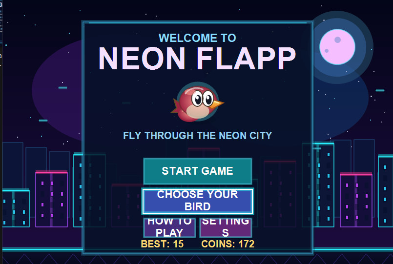
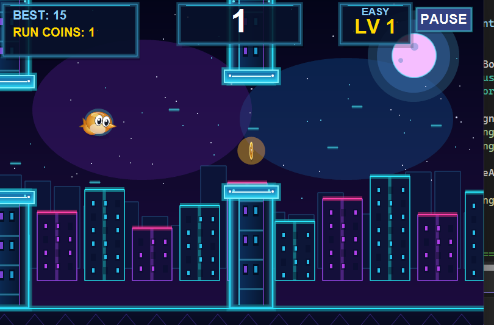
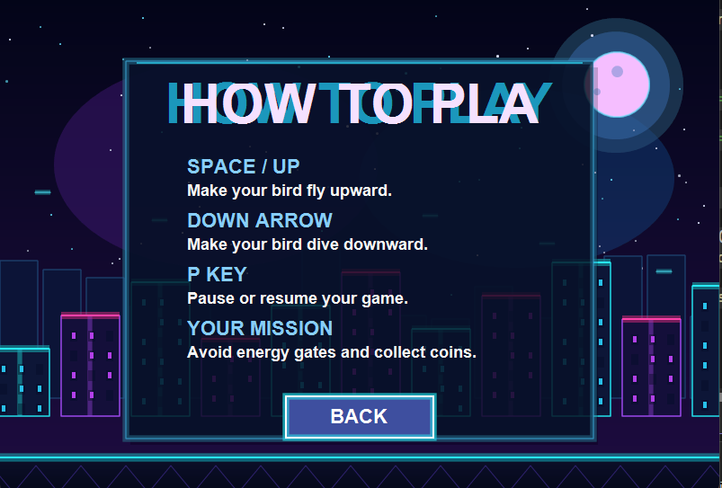
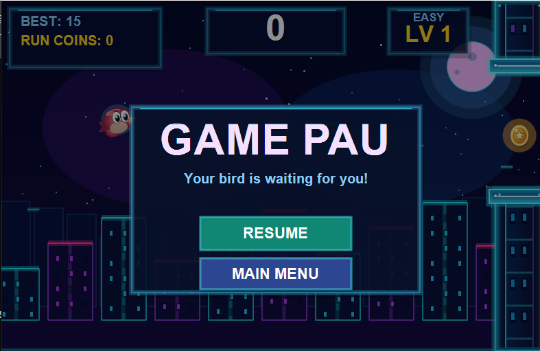
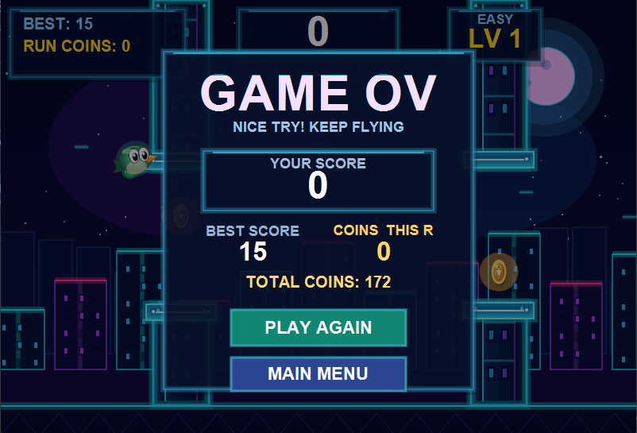

# 🐦 NEON FLAPPY

<p align="center">
  <strong>Neon şehir atmosferinde klasik Flappy Bird deneyimi</strong><br>
  C# • .NET 10 • Windows Forms • GDI+
</p>

<p align="center">
  
  
  
  
</p>

---

## 📌 Proje Hakkında

**NEON FLAPPY**, Fırat Üniversitesi Yazılım Mühendisliği bölümü **YMH219 – Nesne Tabanlı Programlama** dersi kapsamında C# ve Windows Forms kullanılarak geliştirilen 2D bir masaüstü arcade oyunudur.

Oyuncu, dört farklı kuş karakterinden birini seçer ve neon ışıklı bir şehirde engellerin arasından geçmeye çalışır. Engelleri aşarak puan kazanır, uçuş sırasında altın coin'leri toplar ve kendi en yüksek puanını geliştirmeyi hedefler.

Oyunun arayüzü, arka planı, kuşu, engelleri ve coin görselleri harici görsel dosyalar kullanılmadan **GDI+ (System.Drawing)** ile kod üzerinden çizilir.

## 🖼️ Oyun Görselleri

| Ana Menü | Oyun Ekranı |
|:---:|:---:|
|  |  |

| Kuş Seçimi | Nasıl Oynanır? |
|:---:|:---:|
|  |  |

| Duraklatma | Game Over |
|:---:|:---:|
|  |  |


## ✨ Oyun Özellikleri

### 🌃 Neon Night görsel teması
- Koyu mavi ve mor tonlardan oluşan degrade gece gökyüzü.
- Parlayan yıldızlar ve ay.
- Uzak şehir silüeti ve neon ışıklı binalar.
- Hareket eden ışık efektleri ve neon çizgili zemin.
- Neon çerçeveli, enerji kapılı bina biçiminde engeller.

### 🐤 Kuş karakterleri
Oyunda seçilebilir dört kuş türü bulunur:

| Karakter adı | Kod karşılığı |
|---|---|
| SUNNY | `BirdType.Yellow` |
| CYBER | `BirdType.Blue` |
| BLAZE | `BirdType.Red` |
| NOVA | `BirdType.Green` |

Kuş; kanat hareketi animasyonuna, uçuş hızına bağlı dönüş açısına, zıplama ve dalış hareketlerine sahiptir.

### 🚧 Engel sistemi
- Engeller üst ve alt bölümlerden oluşan bir geçiş boşluğu oluşturur.
- Engeller sağdan sola hareket eder.
- Her yeni engel için geçiş boşluğunun dikey konumu yeniden belirlenir.
- Kuş engelin üst veya alt bölümüne temas ederse oyun sona erer.

### 🪙 Coin sistemi
- Her engel çifti için bir coin oluşturulur.
- Coin, ilgili engelin geçiş boşluğu içinde konumlandırılır.
- Coin kendi etrafında dönüyormuş gibi görünür ve parlama animasyonuna sahiptir.
- Kuş coin ile temas ettiğinde coin toplanır; koşu ve toplam coin sayıları artar.

### 🏆 Puan ve seviye sistemi
- Kuş bir engel çiftini tamamen geçtiğinde puan kazanır.
- Her 5 puanda bir seviye yükselir.
- Seviye yükseldikçe engel hızı artar, engeller arasındaki yatay mesafe ve geçiş boşluğu azalır.
- Seviye sistemi en fazla 8. seviyeye kadar çıkar.
- Seviye yükseldiğinde ekranda kısa süreli **LEVEL UP!** bildirimi görünür.
- Zorluk adları: **EASY**, **NORMAL**, **HARD**, **EXPERT**.

### ⏸️ Oyun ekranları
- Ana Menü
- Kuş Seçimi
- How to Play (Nasıl Oynanır?)
- Oyun ekranı
- Settings (Ayarlar)
- Pause (Duraklatma)
- Game Over

### ⚙️ Ayarlar
Settings ekranında **Visual Effects** seçeneği açılıp kapatılabilir. Bu seçenek, coin toplandığında görünen kısa süreli **+1 COIN!** görsel bildirimini kontrol eder. Oyun kodunda ses sistemi bulunmadığından bu seçenek ses açma/kapatma ayarı değildir.

## 🎮 Kontroller

| Tuş / İşlem | İşlev |
|---|---|
| `Space` veya `↑` | Oyunu başlatır veya kuşu zıplatır. |
| `↓` | Oyun sırasında kuşun daha hızlı aşağı inmesini sağlar (dive). |
| `P` | Devam eden oyunu duraklatır veya devam ettirir. |
| `Escape` | Talimat veya kuş seçimi ekranını kapatır; oyun duraklatılmışsa devam ettirir. |
| `Enter` | Game Over ekranında yeni oyunu başlatır. |
| Fare tıklaması | Menü seçeneklerini seçer; oyun sırasında kuşu zıplatır. |
| Pause düğmesi | Oyun ekranındaki duraklatma menüsünü açar. |

Duraklatma ekranındaki **RESUME** oyuna devam eder. **MAIN MENU** seçeneği mevcut koşuyu sıfırlayarak ana menüye döner.

## 🧠 Oyun Mekanikleri

### Kuş fiziği
Kuşun dikey hareketi hız (velocity), yerçekimi (gravity), zıplama kuvveti (jump force) ve maksimum düşüş hızı kullanılarak hesaplanır.

| Parametre | Kodda kullanılan değer |
|---|---:|
| Gravity | `0.32f` |
| Jump Force | `-7.2f` |
| Maximum Fall Speed | `7.2f` |
| Dive sırasında hız artışı | `2.8f` |

Kuşun kanat animasyonu güncellenir. Dikey hareket hızına göre hedef dönüş açısı hesaplanır ve yumuşak geçişle uygulanır.

### Zorluk değerleri
Oyun ilerledikçe kullanılan temel değerler:

| Parametre | Başlangıç | Sınır |
|---|---:|---:|
| Engel hızı | 4 | En fazla 7 |
| Engeller arası mesafe | 400 px | En az 330 px |
| Geçiş boşluğu | 170 px | En az 135 px |
| Seviye başına puan | 5 | — |
| Maksimum seviye | 8 | — |

### Çarpışma kontrolü
Oyun aşağıdaki durumlarda sona erer:
- Kuş ekranın üst sınırını aşarsa.
- Kuş zemine temas ederse.
- Kuş üst veya alt engel alanlarından biriyle çarpışırsa.

## 🏗️ Teknik Yapı ve Sınıflar

Proje, oyun nesnelerinin ve sorumluluklarının ayrı sınıflarda tutulduğu nesne yönelimli bir yapıya sahiptir.

| Sınıf / Enum | Görevi |
|---|---|
| `Program` | Uygulamanın giriş noktasıdır ve `Form1` penceresini başlatır. |
| `Form1` | Ana pencereyi, menüleri, klavye/fare girdilerini, oyun döngüsünü ve çizim işlemlerini yönetir. |
| `Bird` | Kuşun türünü, konumunu, hızını, zıplama/dalış hareketlerini, animasyonunu ve çizimini yönetir. |
| `Pipe` | Engel konumunu, geçiş boşluğunu, hareketini, puan kontrolünü, çarpışma alanlarını ve çizimini yönetir. |
| `Coin` | Coin konumunu, dönüş/parlama animasyonunu, toplanma kontrolünü ve çizimini yönetir. |
| `GameManager` | Oyun durumunu, puanı, seviyeyi, zorluğu, nesnelerin güncellenmesini ve çarpışma kontrolünü koordine eder. |
| `PlayerData` | En yüksek puanı ve toplam coin sayısını yerel dosyadan yükler ve dosyaya kaydeder. |
| `BirdType` | Dört kuş türünü tanımlayan enum'dur. |

### Sınıflar arasındaki temel ilişki

- `Form1`, kullanıcı girdilerini alır ve oyun ekranını çizer.
- `Form1`, oyun kurallarını ve nesnelerin güncellenmesini `GameManager` üzerinden yürütür.
- `GameManager`, `Bird`, `Pipe` ve `Coin` nesnelerini yönetir.
- `PlayerData`, kalıcı oyuncu verilerinin dosya işlemlerini üstlenir.

## 🔄 Oyun Döngüsü

Oyun, Windows Forms Timer kullanır. Timer aralığı kodda **20 milisaniye** olarak ayarlanmıştır.

Oyun aktif, duraklatılmamış ve başka bir menü ekranı açık değilse her Timer adımında:
1. Önceki coin ve seviye değerleri kontrol edilir.
2. Zorluk değerleri güncellenir.
3. Kuşun hareketi güncellenir.
4. Engeller ve coin'ler hareket ettirilir.
5. Geçilen engeller için puan hesaplanır.
6. Coin toplama kontrolleri yapılır.
7. Ekran dışına çıkan engeller yeniden konumlandırılır.
8. Çarpışma kontrolü yapılır.
9. Form yeniden çizilir.

## 💾 Oyuncu Verilerinin Kaydedilmesi

Oyun iki kalıcı bilgiyi saklar:
- **Best Score:** Oyuncunun ulaştığı en yüksek puan.
- **Total Coins:** Tüm koşularda topladığı toplam coin sayısı.

Veriler Windows kullanıcısının Local Application Data klasöründe tutulur:

```text
%LOCALAPPDATA%\YMH219_FlappyBird\playerdata.txt
```

Dosyanın:
- İlk satırında en yüksek puan,
- İkinci satırında toplam coin sayısı bulunur.

Mevcut koşuda toplanan coin sayısı (`RunCoins`) ayrıca Game Over ekranında gösterilir; kalıcı toplam coin sayısı (`TotalCoins`) ile aynı değer değildir.

## 🛠️ Kullanılan Teknolojiler

| Teknoloji | Projedeki kullanım |
|---|---|
| **C#** | Oyun mantığı, sınıflar ve nesne yönelimli programlama |
| **.NET 10 (net10.0-windows)** | Uygulamanın hedef çalışma platformu |
| **Windows Forms** | Masaüstü penceresi ve kullanıcı etkileşimi |
| **System.Drawing / GDI+** | Arka plan, karakterler, engeller, coin'ler, metinler ve efektlerin çizimi |
| **Windows Forms Timer** | Oyun güncelleme döngüsü |
| **Git & GitHub** | Kaynak kodun sürüm kontrolü ve paylaşımı |
| **Visual Studio** | Geliştirme, derleme ve hata ayıklama |


## 🚀 Kurulum ve Çalıştırma

### Gereksinimler
- Windows işletim sistemi.
- Visual Studio ve **.NET masaüstü geliştirme** iş yükü.
- .NET 10 SDK.

### Depoyu klonlama

```powershell
git clone https://github.com/yaseminu0/YMH219-FlappyBird.git
cd YMH219-FlappyBird
```

### Visual Studio ile çalıştırma
1. Depoyu Visual Studio ile aç.
2. `YMH219-FlappyBird.csproj` dosyasını Visual Studio ile aç.
3. Gerekli .NET SDK'nın yüklü olduğundan emin ol.
4. **Build > Build Solution** ile projeyi derle.
5. **F5** ile uygulamayı başlat.

## 📁 Proje Dosyaları

Temel kaynak dosyaları:

```text
YMH219-FlappyBird/
├── Program.cs
├── Form1.cs
├── Form1.Designer.cs
├── Bird.cs
├── Pipe.cs
├── Coin.cs
├── GameManager.cs
├── PlayerData.cs
├── .gitignore
├── README.md
├── main-menu.png
├── gameplay.png
├── bird-selection.png
├── how-to-play.png
├── pause.png
└── game-over.png
```

Oyun görselleri eklendiğinde depo yapısına ayrıca şu klasör eklenebilir:

```text

├── main-menu.png
├── gameplay.png
├── bird-selection.png
├── how-to-play.png
├── pause.png
└── game-over.png
```

## 👩‍💻 Geliştirici

**Yasemin Ubeyd**  
GitHub: [@yaseminu0](https://github.com/yaseminu0)  
Repository: [YMH219-FlappyBird](https://github.com/yaseminu0/YMH219-FlappyBird)

---

<p align="center">
  <strong>Fırat Üniversitesi</strong><br>
  Yazılım Mühendisliği • YMH219 – Nesne Tabanlı Programlama
</p>
